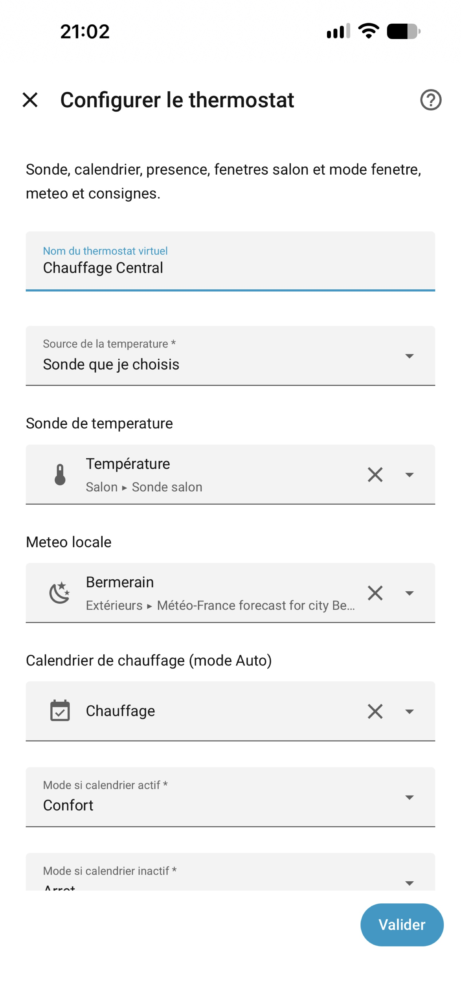
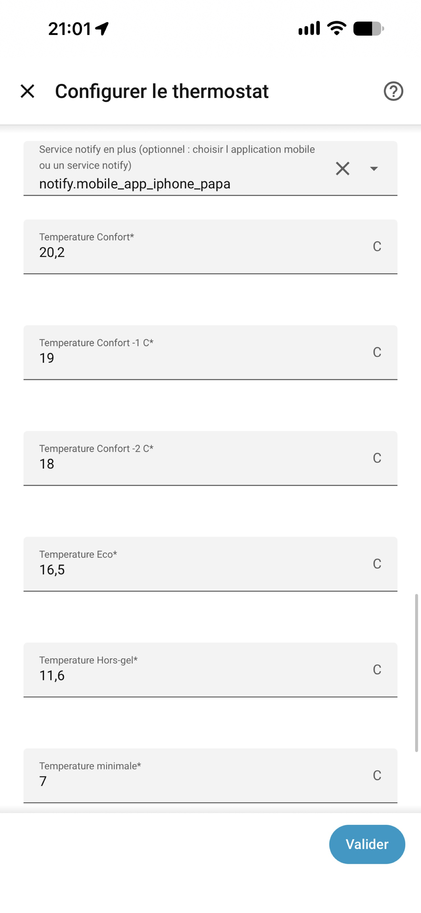
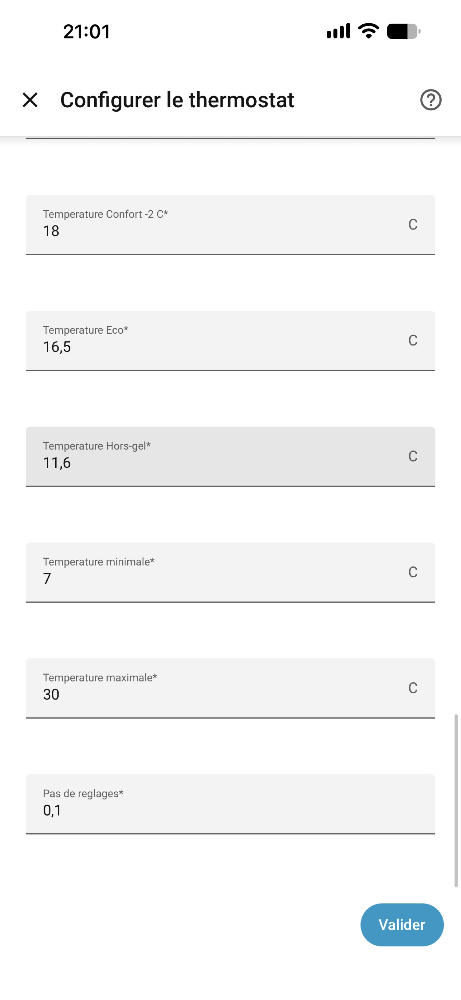
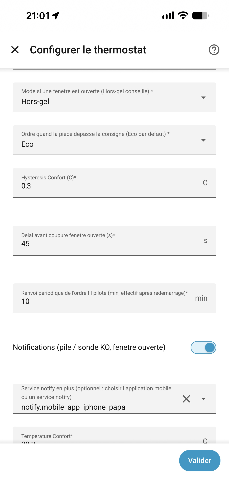
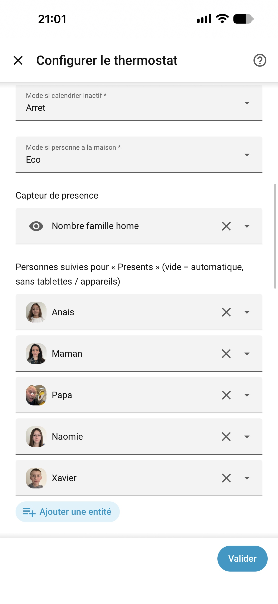
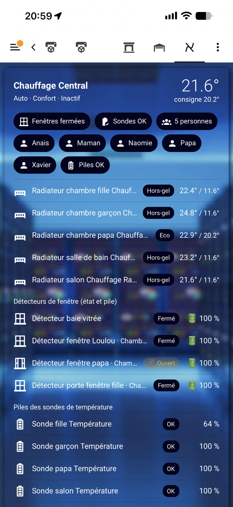

# Chauffage Électrique Fil Pilote FR

<p align="center"></p>

🇫🇷 Français · 🇬🇧 [English version](https://github.com/XAV59213/chauffage/blob/main/README.en.md)

Integration Home Assistant **100 % locale** pour les radiateurs electriques francais a **fil pilote**.

**NodOn SIN-4-FP-21 • Legrand • Delta Dore • sondes Zigbee • Zigbee2MQTT / ZHA • aucun cloud**

[](https://hacs.xyz) [](https://github.com/XAV59213/chauffage/releases/latest) [](https://github.com/XAV59213/chauffage/actions/workflows/validate.yml) [](https://github.com/XAV59213/chauffage/actions/workflows/validate.yml) [](LICENSE) [](https://github.com/XAV59213/chauffage/releases) [](https://github.com/XAV59213/chauffage/releases/latest) [](https://www.home-assistant.io)

[](https://www.buymeacoffee.com/xav59213)

## Via HACS (recommandé)

[](https://my.home-assistant.io/redirect/hacs_repository/?owner=XAV59213&repository=chauffage&category=integration)

[](https://my.home-assistant.io/redirect/config_flow_start/?domain=electric_heater)


**Wiki** : [Accueil](https://github.com/XAV59213/chauffage/blob/main/wiki/Home.md) · [Configuration](https://github.com/XAV59213/chauffage/blob/main/wiki/Configuration.md) · [Fonctionnement](https://github.com/XAV59213/chauffage/blob/main/wiki/Fonctionnement.md) · [Carte](https://github.com/XAV59213/chauffage/blob/main/wiki/Carte.md) · [Notifications](https://github.com/XAV59213/chauffage/blob/main/wiki/Notifications.md) · [Depannage](https://github.com/XAV59213/chauffage/blob/main/wiki/Depannage.md) · 🇬🇧 [Wiki EN](https://github.com/XAV59213/chauffage/blob/main/wiki/Home-EN.md)

---

## Principe

Le **thermostat principal est virtuel**. Home Assistant cree `climate.electric_heater_central`.

Il expose les **6 ordres fil pilote** et les envoie a tous les radiateurs equipes d'un relais.

| Mode fil pilote | Preset Home Assistant |
|---|---|
| Confort | `comfort` |
| Confort -1 C | `comfort_-1` |
| Confort -2 C | `comfort_-2` |
| Eco | `eco` |
| Hors-gel | `frost_protection` |
| Arret | `off` |

Chaque piece a sa **sonde**, son **relais** et éventuellement sa **fenetre**.

---

## Modes du thermostat

| Mode HVAC | Role |
|---|---|
| **Auto** | Calendrier, presence, fenetres. Consigne visible et reglable. |
| **Chauffage** | Mode + consigne envoyes tels quels aux radiateurs. |
| **Eteint** | Tous les radiateurs a l'arret. |

En **Auto** :

- calendrier **actif** → Confort (ou dernier Confort -1 / -2)
- calendrier **inactif** → mode configure (Hors-gel par defaut)
- calendrier **indisponible** → dernier mode garde
- **Nombre famille home** = 0 → Eco
- fenetre salon ouverte **plus de 45 s** → tous les radiateurs en mode fenetre (Hors-gel par defaut) ; refermee avant 45 s → rien ne change ; refermee apres → reprise immediate
- mode choisi a la main en Auto → garde jusqu'au prochain changement du calendrier (remettre le thermostat en Auto pour revenir au calendrier tout de suite)

La meteo (`weather.*`) est **affichee** (capteur Temperature exterieure) ; elle ne change pas encore les ordres.

---

## Fonctionnalites

- Thermostat virtuel, 6 modes fil pilote
- Consigne affichee / reglable en Auto, poussee vers les radiateurs
- Attributs `consigne`, `consigne_mode`, `consignes`
- Calendrier / planning pour l'Auto
- Presence = capteur choisi (Nombre famille home)
- Fenetre piece = ce radiateur ; ouvertures salon = tous les radiateurs (mode fenetre : Hors-gel par defaut)
- Mode si une fenetre est ouverte : Hors-gel (defaut), Eco ou Arret, dans **Configurer** ; une fenetre ne fait que baisser l'ordre
- Radiateur regle a la main (mode ou consigne) : garde, aussi apres un redemarrage ; il suit de nouveau le thermostat quand on le remet en **Auto** ou qu'on change le mode du thermostat
- Ordre envoye seulement s'il change ; renvoye au retour d'un relais, s'il differe depuis 15 s, et toutes les 10 min
- Delai 45 s avant le mode fenetre
- Meteo locale (`weather.*`) : temperature exterieure affichee
- Relais `select` (Zigbee2MQTT) ou `climate` (ZHA)

---

## Installation

### HACS (recommande)

1. HACS -> Integrations -> menu -> **Depots personnalises**
2. URL : `https://github.com/XAV59213/chauffage`
3. Categorie : **Integration** -> Ajouter
4. Rechercher **Chauffage Electrique Fil Pilote FR** -> Installer
5. Redemarrer Home Assistant

### Installation manuelle

Copier `custom_components/electric_heater/` dans `config/custom_components/`, puis redemarrer.

Details : [wiki/Configuration.md](https://github.com/XAV59213/chauffage/blob/main/wiki/Configuration.md).

---

## Configuration rapide

1. Ajouter l'integration → thermostat virtuel (sonde, calendrier, presence, fenetres salon, meteo).
2. Ajouter l'integration **a nouveau** pour chaque radiateur (relais + sonde + fenetre piece).
3. Modifier plus tard via **Configurer**.

<p align="center">
  
</p>

<details>
<summary>Autres écrans de configuration</summary>

<p align="center">
  
  
  
  
</p>

</details>

---

## Carte Lovelace

Carte native livrée avec l'intégration : **Chauffage Fil Pilote**.

```yaml
type: custom:electric-heater-card
```

Tableau de bord → **Modifier** → **Ajouter une carte** → chercher **Chauffage Fil Pilote**.
Aucune option nécessaire : thermostat central, radiateurs, fenêtres (état + pile), sondes (pile), présents et alertes sont trouvés automatiquement.

<p align="center">
  
</p>

Options, ressource manuelle et exemples : [examples/lovelace/README.md](https://github.com/XAV59213/chauffage/blob/main/examples/lovelace/README.md).

L'entity_id d'un radiateur = nom de la piece + « Chauffage » + nom de la piece (ex. piece « Salon » → `climate.salon_chauffage_salon`). Verifier dans **Parametres → Entites**.

---

## Depannage

Voir [wiki/Depannage.md](https://github.com/XAV59213/chauffage/blob/main/wiki/Depannage.md).

---

## Licence

MIT · © [XAV59213](https://github.com/XAV59213)

<a href="https://www.buymeacoffee.com/xav59213"></a>

## Historique des décisions (3.1.47)
Chaque radiateur garde ses 200 dernières décisions (persistées). Voir **Outils de développement → États → climate.chauffage_<pièce>** : attributs `historique` (20 dernières), `derniere_decision`, `radiateur_desobeit`. Détails dans le journal HA en ajoutant :
```yaml
logger:
  logs:
    custom_components.electric_heater: info
```

**3.1.48 :** capteur diagnostic « Dernière décision » par radiateur (`sensor.<pièce>_derniere_decision`), visible dans l'onglet Activité de l'appareil, avec l'historique des 20 dernières décisions en attribut.

**3.1.49 :** l'historique indique **qui** a changé la consigne / le mode / le preset (utilisateur, automatisation, thermostat central, système) — attribut `dernier_changement_par` et capteur « Dernière décision » (ex. « Consigne 20,6→22 °C · par Xavier »).

**3.1.50 :** la carte intègre un thermostat natif et les courbes de puissance des radiateurs (rouge > seuil, vert sinon), le tout réglable dans l'éditeur visuel :
```yaml
type: custom:electric-heater-card
afficher_thermostat: true
thermostat_entite: climate.electric_heater_electric_heater_central   # optionnel
afficher_courbes_puissance: true
colonnes: 2
seuil_puissance: 5
puissances_masquees:
  - sensor.radiateur_salon_power
```
