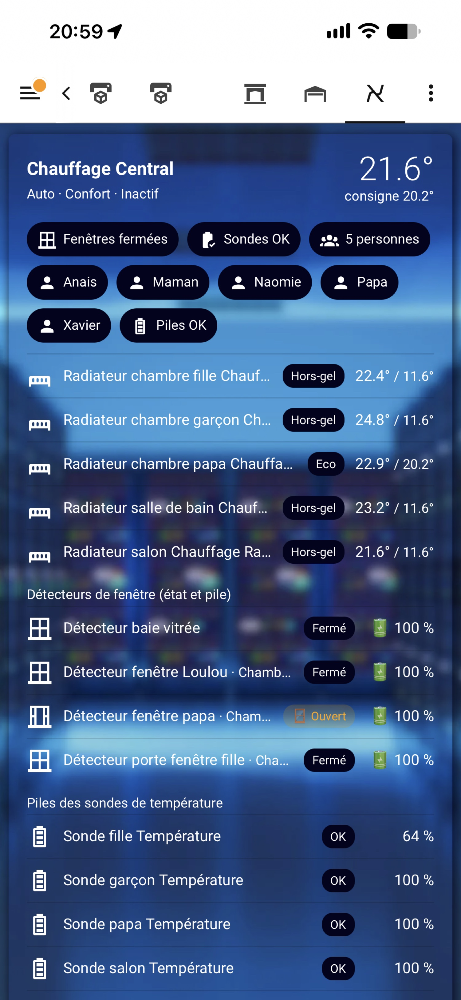

# Carte Lovelace « Chauffage Fil Pilote »

Carte native livrée avec l'intégration (à partir de la 3.1.7) : rien à installer en plus.

```yaml
type: custom:electric-heater-card
```

<p align="center">
  
</p>

Après mise à jour (HACS) : **redémarre Home Assistant** puis vide le cache du navigateur (ou recharge l'app).
Tableau de bord → **Modifier** → **Ajouter une carte** → cherche **Chauffage Fil Pilote**.

La carte trouve **toute seule** :
- le thermostat central (`climate.electric_heater_central`) ;
- **tous les radiateurs** déjà ajoutés à l'intégration (ordre fil pilote, température / consigne, fenêtre, sonde KO) ;
- les capteurs résumé : fenêtres ouvertes, sondes KO / alerte pile, présents (avec les prénoms) ;
- l'état des **piles des détecteurs de fenêtre** (capteur batterie du même appareil) : `%` et « Pile faible » à 20 % ou moins.

Un clic sur une ligne ouvre la fiche de l'entité.

Si elle n'apparaît pas dans la liste des cartes :

**Paramètres → Tableaux de bord → ⋮ → Ressources → Ajouter**

- URL : `/electric_heater/electric-heater-card.js`
- Type : Module JavaScript

## Plusieurs bâtiments (dépendances)

Avec plusieurs bâtiments, la carte affiche **un onglet par bâtiment** (nom du bâtiment), chacun avec son
thermostat, ses radiateurs, ses fenêtres, ses alertes et sa consommation, ainsi que le total
**« Toutes dépendances »** du jour (temps de chauffe et consommation). Avec un seul bâtiment, rien ne change.

Pour n'afficher qu'un bâtiment (une carte par dépendance, par exemple), épinglez-le avec l'option `batiment`.
Dans l'éditeur visuel, c'est la liste déroulante « Bâtiment affiché ».

```yaml
type: custom:electric-heater-card
batiment: Gîte
```

La découverte passe par le registre de Home Assistant (thermostats, radiateurs rattachés, capteurs de
chaque appareil) : elle ne dépend ni des entity_id ni de la langue. Avec des onglets, les options `central`
et `radiateurs` sont ignorées (chaque onglet montre son bâtiment) ; elles restent utilisables avec un seul
bâtiment ou un bâtiment épinglé.

## Options (facultatif, seulement si la découverte ne convient pas)

```yaml
type: custom:electric-heater-card
titre: Chauffage maison
central: climate.electric_heater_central
radiateurs:
  - climate.radiateur_salon_chauffage_radiateur_salon
  - climate.radiateur_chambre_papa_chauffage_radiateur_chambre_papa
fenetres: sensor.chauffage_central_fenetres_ouvertes
sondes_ko: sensor.chauffage_central_sondes_ko
alerte_pile: binary_sensor.chauffage_central_alerte_pile_sonde
presents: sensor.chauffage_central_presents
detecteurs_fenetre:
  - binary_sensor.fenetre_papa_3
```

Sans ces clés, la découverte automatique est utilisée.
Une vue YAML classique (cartes natives HA) reste disponible : [`../lovelace-statut-chauffage.yaml`](../lovelace-statut-chauffage.yaml).
