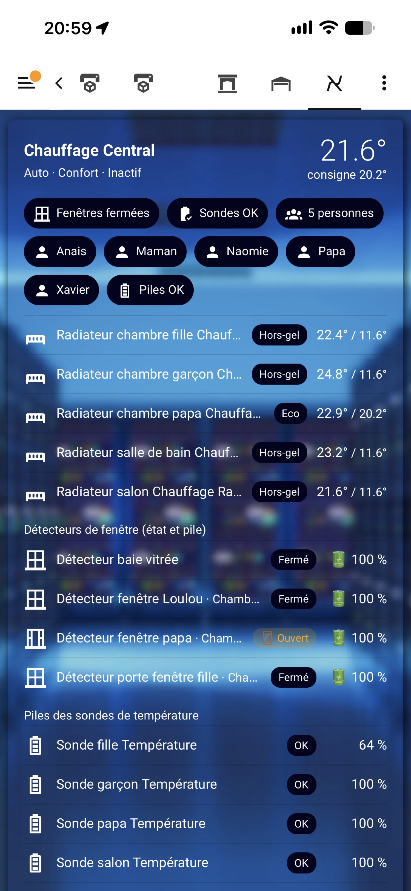

# Lovelace card "Chauffage Fil Pilote"

🇫🇷 [Français](Carte.md) · 🇬🇧 English

Shipped with the integration (since 3.1.7), nothing extra to install.

```yaml
type: custom:electric-heater-card
```

Dashboard → **Edit** → **Add card** → **Chauffage Fil Pilote**.



## What it shows (auto-discovery)

- Central thermostat: temperature, setpoint, mode, heating / idle.
- Chips: open windows, KO sensors, people home (with names), batteries.
- Each radiator: pilot wire order, temperature / setpoint, window, sensor KO.
- **Window detectors**: Open / Closed + battery (%). Detectors configured on the thermostat and each radiator, plus those in the same HA area.
- **Batteries of room temperature sensors**.

## Options (fallback)

`titre`, `central`, `radiateurs`, `fenetres`, `sondes_ko`, `alerte_pile`, `presents`, `detecteurs_fenetre`, `sondes`, `exclure_personnes`.

If the card does not appear: Settings → Dashboards → Resources → `/electric_heater/electric-heater-card.js` (JavaScript module).
