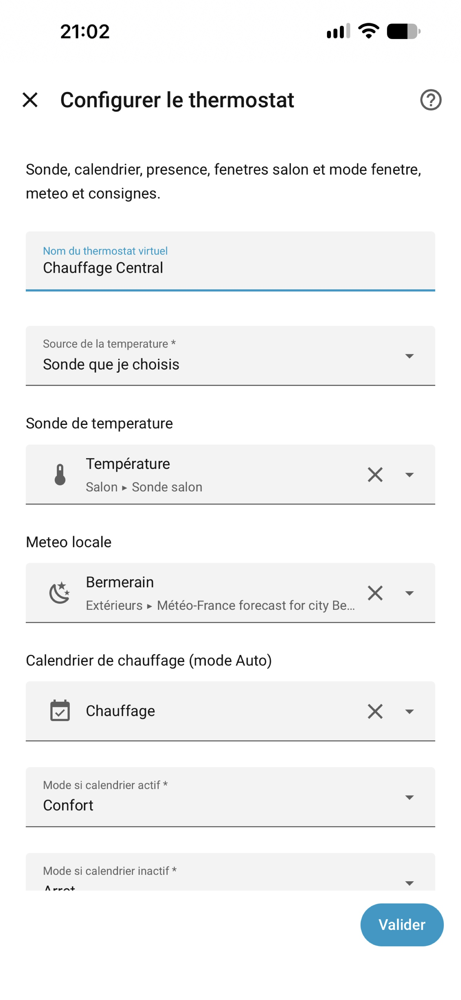

# Configuration

## Installation

HACS → Dépôts personnalisés → `https://github.com/XAV59213/chauffage` → catégorie Integration → installer → redémarrer.

## 1. Thermostat virtuel

Paramètres → Appareils et services → Ajouter → **Chauffage Electrique Fil Pilote FR**

| Champ | Usage |
|---|---|
| Nom | Ex. Thermostat virtuel |
| Source de température | Sonde choisie **ou** moyenne des pièces |
| Sonde | `sensor` température du salon |
| Météo locale | Entité `weather.*` (optionnel, affichage de la température extérieure) |
| Calendrier | `calendar.*` ou `schedule.*` pour l'Auto |
| Mode si calendrier actif | Souvent Confort |
| Mode si calendrier inactif | Hors-gel par défaut |
| Mode si personne à la maison | Souvent Eco |
| Capteur de présence | **Nombre famille home** |
| Personnes suivies | Cocher les vraies personnes (Papa, Maman…). Vide = automatique ; tablettes, iPad, mqtt, MAISON exclus |
| Fenêtres salon | Baie, portes, fenêtre → tous les radiateurs en mode fenêtre |
| Mode si une fenêtre est ouverte | Hors-gel par défaut (ou Eco, Arrêt) |
| Consignes | Confort, -1, -2, Eco, Hors-gel (arrondies à 0,1 °C ; Hors-gel 5 à 15 °C) |
| Ordre au-dessus de la consigne | Eco (défaut), Hors-gel ou Arrêt |
| Hystérésis Confort | 0,3 °C par défaut |
| Délai fenêtre ouverte | 45 s par défaut |
| Renvoi périodique fil pilote | 10 min par défaut (pris en compte après redémarrage) |
| Notifications | Activées par défaut (voir [Notifications](Notifications.md)) |
| Service notify en plus | Liste des `notify.*` (application mobile en premier) |

Entité : `climate.electric_heater_central`.

## 2. Chaque radiateur

Ajouter **à nouveau** l'intégration pour chaque pièce.

| Champ | Usage |
|---|---|
| Nom | Ex. Chambre papa |
| Relais fil pilote | `select.*pilot_wire_mode` ou `climate` |
| Sonde de la pièce | Obligatoire |
| Fenêtre(s) de la pièce | **Ce** radiateur seulement passe en mode fenêtre |

## 3. Modifier plus tard

Sur l'entrée → **Configurer**. Pas besoin de tout recréer.

